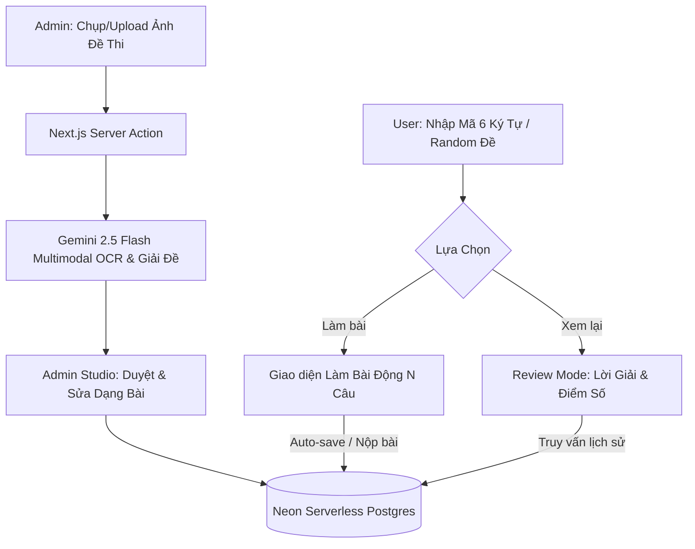

# Thiết kế Hệ thống Số hóa & Luyện đề Tiếng Anh (English Platform)

- **Ngày lập**: 2026-10-11
- **Trạng thái**: Đã phê duyệt (Validated)
- **Công nghệ chính**: Next.js (App Router, TypeScript) + Tailwind CSS + Neon Postgres (Drizzle ORM) + Google Gemini API (`gemini-2.5-flash`).

---

## 1. Mục tiêu & Luồng nghiệp vụ cốt lõi

Hệ thống phục vụ 2 nhóm người dùng chính:
1. **Quản trị viên (Admin)**: Chụp/Tải nhiều ảnh đề thi giấy lên hệ thống $\rightarrow$ Gemini OCR & giải đề $\rightarrow$ Admin duyệt và chỉnh sửa trực quan theo từng dạng bài $\rightarrow$ Lưu vào Neon Postgres kèm mã định danh 6 ký tự không trùng lặp (ví dụ: `K8X2M9`).
2. **Học sinh (User)**:
   - Tìm kiếm đề theo mã 6 ký tự hoặc chọn làm ngẫu nhiên.
   - Khi tìm thấy đề: Lựa chọn **Làm bài mới** hoặc **Xem lại đề / Xem lịch sử các lần làm trước**.
   - Làm bài trên giao diện đề thi trắng tương tác, hỗ trợ lưu nháp (`draft`), chia đôi màn hình cho bài đọc hiểu, ô nhập từ sửa lỗi cho dạng bài tìm lỗi sai.
   - Nộp bài khi làm đủ $N$ câu ($N = 30, 40, 50...$) $\rightarrow$ Chấm điểm hệ 10 tức thì $\rightarrow$ Chế độ Review chi tiết (đối chiếu đáp án, từ sửa lỗi, giải thích chi tiết, lọc các câu làm sai).
   - Trang Lịch sử & Thống kê: Theo dõi số lần làm, tiến bộ điểm số qua từng lần làm của mỗi đề.

---

## 2. Kiến trúc Hệ thống & Cơ sở dữ liệu (Neon Postgres)



### Schema Bảng CSDL (Drizzle ORM)

```typescript
// 1. Người dùng & Phân quyền
users: {
  id: uuid (PK),
  username: varchar(50) (unique),
  email: varchar(255) (unique),
  password_hash: text,
  role: 'admin' | 'user',
  created_at: timestamp
}

// 2. Đề thi (Dynamic N questions)
exams: {
  id: uuid (PK),
  code: varchar(6) (unique, indexed), // Mã 6 ký tự như K8X2M9
  title: varchar(255),               // Tên đề, ví dụ: "Practice Test 6"
  total_questions: integer,          // 30, 40, 50... linh hoạt
  created_by: uuid (FK -> users.id),
  created_at: timestamp
}

// 3. Các phần thi & Đoạn văn đọc hiểu
sections: {
  id: uuid (PK),
  exam_id: uuid (FK -> exams.id),
  title: text,                       // Hướng dẫn: "Mark the letter A, B, C, or D..."
  passage_text: text (nullable),     // Bài đọc hiểu dài (nếu có)
  order_index: integer
}

// 4. Chi tiết từng câu hỏi
questions: {
  id: uuid (PK),
  section_id: uuid (FK -> sections.id),
  question_number: integer,          // 1 .. N
  question_type: varchar(50),        // 'pronunciation', 'stress', 'error_correction', 'multiple_choice', 'reading', 'dialogue'
  prompt: text,                      // Câu hỏi
  options: jsonb,                    // { A: "...", B: "...", C: "...", D: "..." }
  underlined_parts: jsonb (nullable),// Mảng lưu vị trí gạch chân
  correct_answer: char(1),           // 'A' | 'B' | 'C' | 'D'
  correction_text: text (nullable),  // Từ sửa đúng cho câu tìm lỗi sai
  explanation: text,                 // Lời giải thích tiếng Việt
  order_index: integer
}

// 5. Tiến trình làm bài, Lưu nháp & Lịch sử
exam_attempts: {
  id: uuid (PK),
  user_id: uuid (FK -> users.id),
  exam_id: uuid (FK -> exams.id),
  attempt_number: integer,           // Lần làm thứ 1, 2, 3...
  status: 'draft' | 'completed',     // 'draft' (làm dở) | 'completed' (đã nộp)
  answers: jsonb,                    // { [q_num]: { selected: 'A', correction_input: 'were' } }
  total_correct: integer,
  score: numeric(4, 2),              // Điểm hệ 10 = (total_correct / total_questions) * 10
  completed_at: timestamp
}
```

---

## 3. Luồng Quản trị viên (Admin Workflow)

1. **Upload Nhiều Ảnh**: Chụp ảnh hoặc tải lên 1-4 trang đề.
2. **AI Multimodal Extraction**: Gemini trích xuất cấu trúc đề thi thành JSON chuẩn:
   - Tự động nhận diện tổng số câu thực tế $N$.
   - Tách riêng các đoạn văn đọc hiểu gắn vào `sections`.
   - Nhận diện đúng các vị trí gạch chân (Pronunciation, Error Correction).
   - Tự giải đề, xác định `correct_answer`, `correction_text`, và sinh `explanation` tiếng Việt.
3. **Admin Studio (Editor)**:
   - Tự động sinh mã 6 ký tự ngẫu nhiên duy nhất (custom NanoID uppercase).
   - Bộ công cụ sửa đổi linh hoạt theo `question_type`:
     - *Phát âm/Trọng âm*: Cho phép tô gạch chân phần âm.
     - *Tìm lỗi sai*: Sửa 4 phần gạch chân A/B/C/D + sửa từ đúng `correction_text`.
     - *Đọc hiểu*: Cột trái sửa đoạn văn; cột phải sửa các câu hỏi liên quan.
   - Sửa đáp án đúng và chỉnh sửa giải thích chi tiết.
   - Bấm *"Xuất bản đề thi"* để lưu trọn vẹn vào Neon Postgres.

---

## 4. Luồng Học sinh (Student Workflow)

### 4.1. Tìm kiếm & Khởi tạo (Search & Hub)
- **Hộp tìm kiếm 6 ký tự**: Nhập mã (ví dụ `K8X2M9`):
  - Hiển thị bảng thông tin đề: Tên đề, Tổng số câu ($N$ câu), Lịch sử đã làm (ví dụ: *Đã làm 2 lần - Điểm cao nhất: 8.4*).
  - 3 nút hành động trực tiếp:
    1. **"Vào làm bài mới"**: Bắt đầu một lượt làm mới (Attempt mới).
    2. **"Tiếp tục bài dở"** (nếu đang có bản nháp `draft`).
    3. **"Xem lại đề & Lời giải" (Study/Review Mode)**: Mở ngay toàn bộ đề thi có sẵn đáp án và giải thích để ôn tập.
- **Nút "Làm đề ngẫu nhiên"**: Bốc tự động 1 đề chưa làm hoặc làm ít nhất $\rightarrow$ Mở thẳng đề thi.

### 4.2. Giao diện Làm bài (Exam Studio)
- **Đề thi trắng & Tương tác cao**:
  - Không lộ đáp án trước khi nộp bài.
  - Dynamic Question Palette (1..$N$): Đổi màu trạng thái (Đã làm, Chưa làm, Đang chọn).
  - Dạng bài tìm lỗi sai: Chọn A/B/C/D + Ô nhập *"Cách sửa của bạn"*.
  - Dạng bài đọc hiểu: Màn hình chia đôi: Bên trái ghim bài đọc, bên phải làm câu hỏi.
- **Lưu nháp (Draft)**: Tự động lưu tiến trình. Học sinh có thể thoát ra và quay lại làm tiếp bất kỳ lúc nào.
- **Nộp bài**: Kiểm tra điều kiện bắt buộc đã hoàn thành đủ $N$ câu.

### 4.3. Chế độ Xem lại (Review Mode) & Lịch sử Làm bài
- **Bảng tổng kết sau khi nộp**: Điểm số hệ 10, số câu đúng/sai, số lần làm đề này.
- **Chế độ Review trực quan**:
  - Từng câu hỏi hiển thị rõ: Đáp án học sinh chọn vs Đáp án đúng chuẩn (tô đỏ câu sai, tô xanh câu đúng).
  - Đối với câu tìm lỗi sai: So sánh từ học sinh đã gõ với từ sửa chuẩn của đề.
  - Khung giải thích chi tiết (Explanation) bên dưới từng câu.
  - **Bộ lọc thông minh**: Nút *"Chỉ xem câu sai"* giúp học sinh lọc ra danh sách các câu làm sai để rà soát lỗi nhanh chóng.
- **Trang Lịch sử & Thống kê cá nhân**:
  - Danh sách toàn bộ các đề đã làm.
  - Thống kê tiến độ qua từng lần làm (Lần 1: 6.5đ $\rightarrow$ Lần 2: 8.2đ $\rightarrow$ Lần 3: 9.6đ).
  - Bấm vào bất kỳ lần làm nào trong quá khứ để mở lại toàn bộ giao diện bài làm lần đó.
